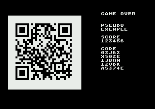

# sgdk-scores

Codes de score signés et QR code pour les jeux Mega Drive faits avec [SGDK](https://github.com/Stephane-D/SGDK).

En fin de partie, le jeu affiche un **code** de 26 caractères et un **QR code**. Le joueur scanne le QR code avec son téléphone : un site de scores vérifie le code et enregistre le score. Le code contient le pseudo, le score et un numéro de partie. Il est signé et chiffré avec une clé propre au jeu, si bien qu'on ne peut ni le modifier ni en inventer un sans la clé.



- Tout est calculé par la console : aucun matériel en plus, aucune connexion.
- C pur, sans allocation, environ 1,5 Ko de RAM. Le QR code met environ 0,7 s à se calculer sur le 68000 : à faire une fois, sur un écran fixe.
- QR code au mode alphanumérique, correction d'erreurs niveau M (15 %), lisible sur une télévision.

## Contenu

| Dossier | Rôle |
|---|---|
| `scores/` | le module C, à copier dans `src/` de votre projet |
| `tools/scores_setup.py` | crée la clé du jeu et le fichier `scores_config.h` |
| `tools/scores_code.py` | format de référence : fabriquer ou décoder un code (pour un site, ou pour vérifier) |
| `example/` | projet SGDK minimal : un écran de fin avec un code et son QR code |
| `tests/` | tests du format, et de l'exemple dans un émulateur (le QR code affiché est relu) |

## Intégration dans un jeu

1. **Copier** le dossier `scores/` dans le `src/` du projet : `src/scores/`. Le makefile de SGDK le compile tout seul.
2. **Générer la clé et le réglage**, une fois puis à chaque compilation (par exemple dans votre script de construction) :

   ```sh
   python sgdk-scores/tools/scores_setup.py --site HTTPS://SCORES.EXEMPLE.NET/ --game MONJEU \
       --key secrets/scores.key --out src/scores_config.h
   ```

   - `--site` : le site des scores. `--game` : l'identifiant du jeu sur ce site (A-Z, 0-9, 12 caractères au plus). Le QR code appellera `HTTPS://SCORES.EXEMPLE.NET/MONJEU/<code>`.
   - L'adresse doit être en **majuscules** (mode alphanumérique du QR code, le plus compact) : chiffres, lettres et `$ % * + - . / :` seulement, 64 caractères au plus. Le nom de domaine ne tient pas compte de la casse ; le site doit accepter un chemin en majuscules.
   - La clé est créée au hasard si le fichier n'existe pas. **Ne versionnez ni `secrets/` ni `scores_config.h`** (ce dernier contient la clé). Gardez la clé : si elle change, les codes des ROM déjà distribuées ne sont plus reconnus.

3. **Afficher le code et le QR code** sur l'écran de fin :

   ```c
   #include "scores/scores.h"
   #include "scores_config.h"          // SCORES_URL, SCORES_KEY

   static ScoresQr qr;                 // 1,1 Ko : en statique, pas sur la pile

   void gameOverScreen(const char* pseudo, u32 score)
   {
       char code[SCORES_CODE_LENGTH + 1], url[100];
       scores_makeCode(SCORES_KEY, pseudo, score, vtimer, code);
       VDP_drawText(code, 1, 26);                          // le texte d'abord : instantané
       if (scores_makeUrl(SCORES_URL, code, url, sizeof(url)) && scores_qrEncode(url, &qr))
           scores_drawQr(&qr, BG_A, 2, 4, PAL1, TILE_USER_INDEX);
   }
   ```

4. **Inscrire le jeu sur le site** : son identifiant et sa clé (contenu de `secrets/scores.key`).

## Référence

| Fonction | Rôle |
|---|---|
| `scores_makeCode(key, pseudo, score, nonce, out)` | code de 26 caractères. `pseudo` : jusqu'à 12 caractères (espace, A-Z, 0-9 ; un autre caractère compte comme un espace). `score` : 0 à 1 048 575. `nonce` : 12 bits pour distinguer deux parties (par exemple `vtimer`). |
| `scores_makeUrl(base, code, out, size)` | adresse complète du QR code ; `FALSE` si `out` est trop petit. |
| `scores_qrEncode(text, &qr)` | QR code d'un texte alphanumérique de 90 caractères au plus (versions 1 à 4, 21 à 33 modules) ; `FALSE` sinon. |
| `scores_drawQr(&qr, plane, x, y, palette, tileIndex)` | dessine le QR code et sa marge claire sur un plan, à partir de la tuile (x, y). Charge 16 tuiles en `tileIndex` et met les couleurs 1 et 2 de `palette` en noir et blanc. |
| `scores_qrTiles(&qr)` | taille du dessin en tuiles (19 en version 3, 21 en version 4). |

Format du code (128 bits) : version (4) | pseudo (2 x 32, base 37) | score (20) | numéro de partie (12) | signature (28 bits, CBC-MAC XTEA, clé de signature = clé XOR A5A5A5A5). Le tout est chiffré en XTEA (CBC, vecteur nul), puis écrit en base 32 de Crockford : `0-9 A-Z` sans `I L O U`. À la saisie, `O` vaut `0`, et `I` ou `L` valent `1`. Implémentation de référence : `tools/scores_code.py`.

```sh
python tools/scores_code.py decode HTTPS://SCORES.EXEMPLE.NET/MONJEU/03J62X50ZE1JBDM1ZVDKA5374E --key secrets/scores.key
python tools/scores_code.py encode PLAYER1 123456 --key secrets/scores.key
```

## Sécurité : ce que la signature protège, et ce qu'elle ne protège pas

- Elle empêche de modifier un code à la main, de le présenter pour un autre jeu (autre clé), ou d'en inventer un : sans la clé, une chance sur 268 millions de tomber juste.
- Elle **n'empêche pas** une triche déterminée : la clé est forcément dans la ROM, et quelqu'un qui la désassemble peut fabriquer des codes pour ce jeu. Une console ne peut pas garder de secret. Pour un concours à enjeu, le site doit ajouter ses propres garde-fous (journal des envois, scores plausibles, vérification des meilleurs).

## Exemple et tests

```sh
python example/build.py             # example/out/rom.bin (SGDK : variable GDK, sinon ../sgdk)
python -m unittest discover -s tests
```

Le test de l'exemple lance la ROM dans Genesis Plus GX (cœur libretro, variable `GPGX_CORE`), décode le code calculé par la console et relit le QR code affiché (`pip install zxing-cpp pillow`). Sans ces outils, seuls les tests du format tournent.

## Utilisé par

- *Venkman* (Mega Drive) : mode concours, site [scores.yannosh.net](https://scores.yannosh.net).

## Licence

MIT (voir `LICENSE`) : libre d'utilisation, y compris dans un jeu vendu, en gardant la mention de copyright.
